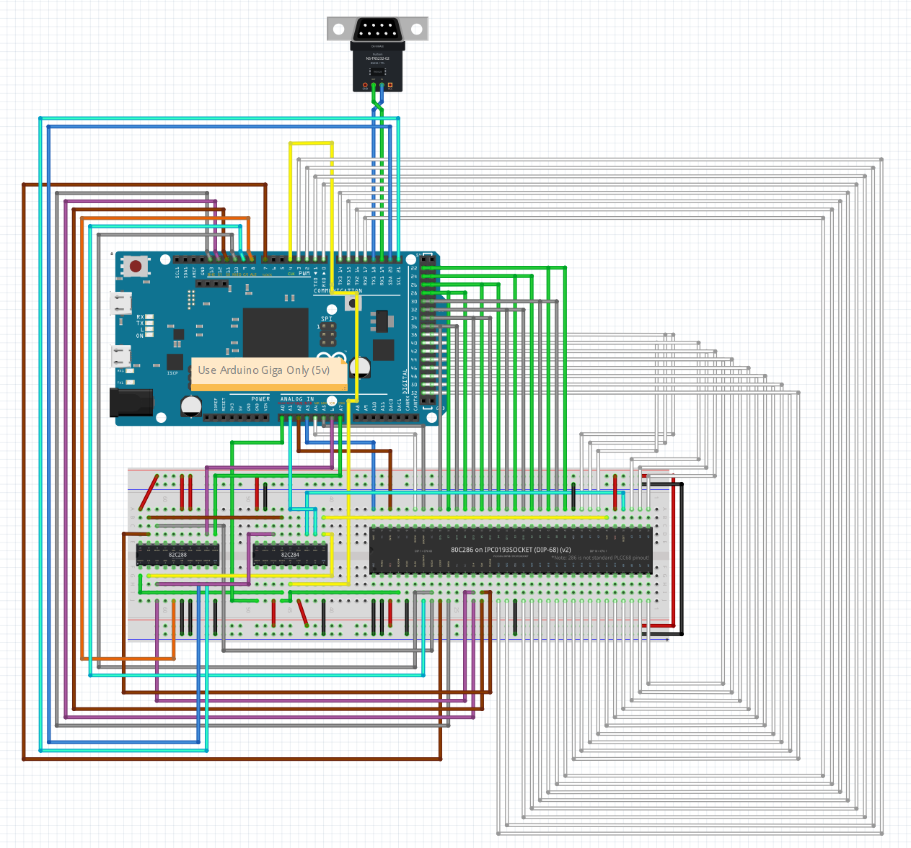
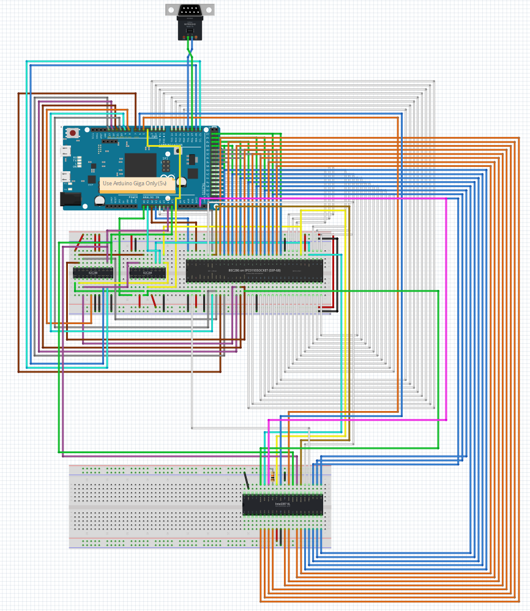

# Fritzing Layouts for ArduinoX86 286 Control

These are two Fritzing projects that provide the breadboard layout and wiring plan to make a controllable 286 using ArduinoX86 and an Arduino GIGA.

## arduino_286_05

A plan for just the 286. Available as Fritzing file and PDF.

## arduino_286_287_XL_01

A plan for the 286 and the 287XL FPU. Available as Fritzing file and PDF.

