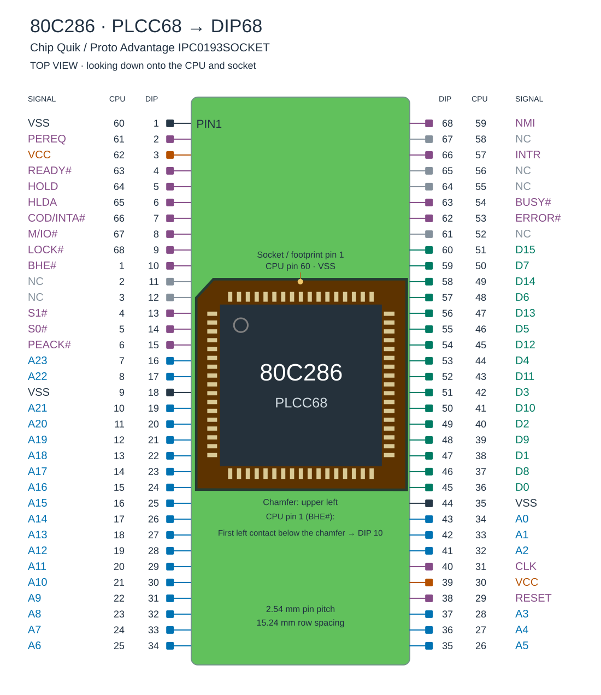

# Fritzing Layouts for ArduinoX86 286 Control

These are two Fritzing projects that provide the breadboard layout and wiring plan to make a controllable 286 using ArduinoX86 and an Arduino GIGA.

Breadboarding a 286 requires use of a [ChipQuik PLCC68 to DIP68 adapter](https://www.mouser.com/en/ProductDetail/Chip-Quik/IPC0193SOCKET?qs=amGC7iS6iy9btL7kgA87lA%3D%3D).

The 286 does not have a standard PLCC68 pin ordering (pin 1 is not at in the top-middle). Specifically, it does not match the pin ordering of the PLCC68 footprint found in KiCad. This can lead to expensive and time-consuming miswirings.

I have provided an annotated pinout of the 286 as installed in aforementioned adapter:

## arduino_286_05

A plan for just the 286. Available as Fritzing file and PDF.

## arduino_286_287_XL_01

A plan for the 286 and the 287XL FPU. Available as Fritzing file and PDF.

